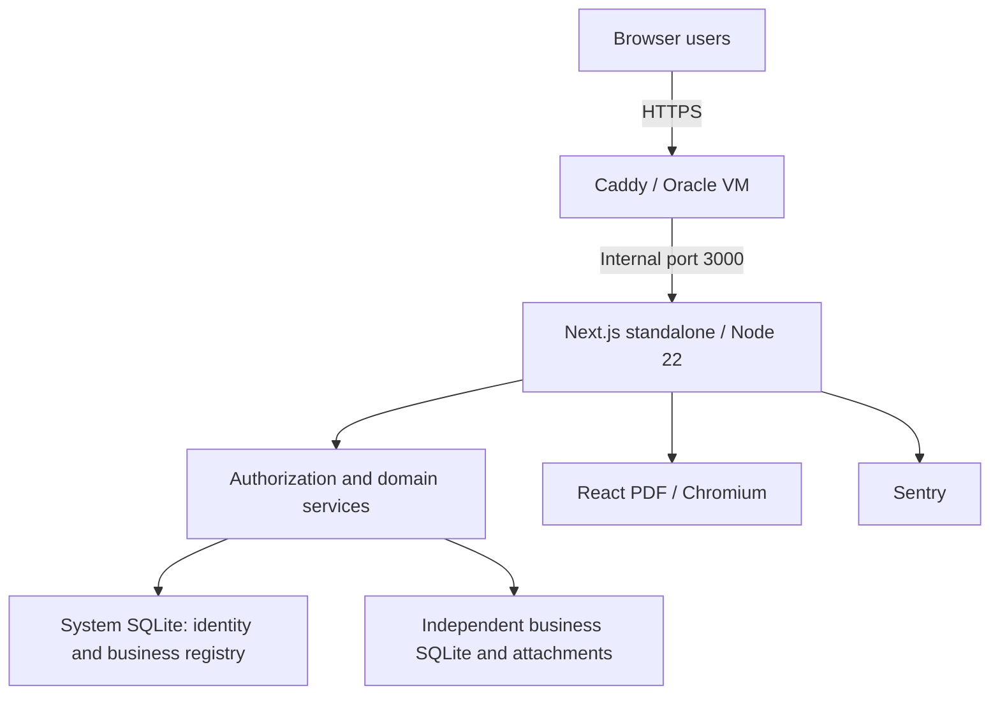
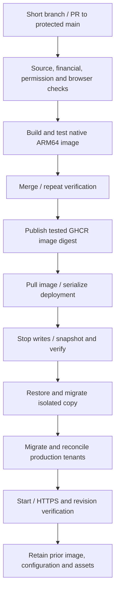

# Ledgerly ERP — architecture and operations dossier

Verified baseline: package **2.7.0**, application revision `32df273e5eeecec3db15f95bd8ba8d0f1cc1cd93`, **26 October 2026**. This replaces the older build-on-server specification, runtime mismatch and unverified zero-downtime/free-tier/compliance claims. [Current state](docs/CURRENT_STATE.md) owns release facts, [deployment](docs/DEPLOYMENT.md) owns procedures, and [next steps](docs/NEXT_STEPS.md) owns the testing plan.

## Architecture and data

The first rollout is a few businesses and **5–10 users**. Keep the modular monolith and isolated SQLite files; no database rebuild or larger platform has been selected. Measure real workloads before introducing separate services or another database.



One app owns React UI, Server Components, actions/routes, auth, domain services, PDFs and storage. Runtime/install are **Node 22 / npm 10.9.4**, locked with `package-lock.json`. Next.js 16.4.3, React 19.2.8, TypeScript 6.0.3, Tailwind 4.3.3, Better Auth 1.6.26, better-sqlite3 13.0.3, Drizzle 0.45.2, decimal.js 10.6.0 and Sentry SDK 10.75.2 are the source snapshot. Version pins/lockfile are authoritative when updated.

```text
data/system/system.sqlite
data/businesses/<trusted-directory-key>/business.sqlite
data/businesses/<trusted-directory-key>/attachments/
```

System tables store users/sessions/account and business membership data; business tables hold accounts/journals, parties/documents/allocations, inventory, banking, projects, payroll, settings and tax data. Last live schema verification: system **6**, all six businesses **35**. Transactions and foreign keys are database-local; cross-database creation/import is not automatically atomic and its lifecycle improvements remain deferred.

Membership and active-account checks select a trusted business directory; the filesystem key is validated. Separate files reduce accidental query crossover but do not replace permissions or isolate a compromised process. Connections use WAL, foreign keys, **synchronous FULL**, and a 5-second busy timeout. The tenant cache caps at 50 with idle eviction. WAL improves concurrency, but writes serialize per file, lock errors remain possible, and synchronous SQLite/report work can delay the Node event loop. Active SQLite files must stay on local storage. A second app replica is not a routine scaling change for this topology.

Explicit migrations validate ordered history/schema/foreign keys. Production uses external migration mode under the deployment lock and checks every registered tenant. Never use `drizzle-kit push` against real data.

## Financial and access boundaries

Currency values use minor-unit integers, checked safe-number conversion and BigInt intermediates. Quantities use **10,000** scale despite `micros` names. FX rates are decimal strings for base currency per foreign unit. Shared rational/decimal helpers implement HALF_UP at defined minor-unit boundaries and aggregate cash-basis allocations without SQL REAL. Storage types alone do not establish correct calculations; regressions and reconciliation are the acceptance evidence.

Posting applies financial effects transactionally where supported and journals must balance. Lock dates guard closed periods. Purchase settlement/aging includes posted debit notes. Payroll posting is transactional/idempotent; posted payroll corrections use void/new draft. Other document correction behavior remains module-specific. A universal immutable audit trail is deferred. VAT snapshots/calculations do not establish cryptographic signing or statutory certification; there is no active PINT-AE/provider integration.

Shared guards cover **147 domain mutations**, including action, batch, conversion, settings and export boundaries, with account-state enforcement. Dashboard/email-history reads filter by allowed modules. UI hiding supplements server checks. Runtime authentication/setup secrets were replaced on the VM, initial sessions/tokens revoked, and secrets excluded from images. Production trusted origins use explicit configuration; ordinary releases retain runtime keys.

## Remote work and delivery



Both required PR checks must pass. Pinned Actions/base images, locked installs, type/lint/tests, permission checks, production audit, production-browser fixtures and deployment recovery scenarios precede promotion. The actual native ARM64 image is tested for migrations/readiness, non-root/secret exclusions, real HTML PDF rendering and committed-WAL/attachment backup recovery. CI retains release metadata and a production npm CycloneDX inventory.

After merge, Actions transfers the exact revision's configuration over verified SSH and supplies a job-scoped registry token to temporary host Docker credentials. The VM does not reset Git, build the app or prune rollback images. GitHub concurrency plus host `flock` serialize deployment/migration. Failed checks block promotion; a successful safe fallback does not turn a failed release green. No workflow can guarantee that every submitted change builds successfully.

## Production and recovery

Oracle `modern-erp`: **me-dubai-1**, A1 Flex ARM64, **2 OCPUs / 12 GB RAM**, Ubuntu 24.04, public host `84.235.255.173`, application https://erp-portal.rapidtss.com. Attached boot volume is **100 GB, 10 VPUs/GB**, no autotune policy, with attachment encryption enabled; IMDSv2-only is verified. Public-subnet security lists permit TCP 22/80/443, VNIC has no NSGs, and app port 3000 is internal. Trial credit was observed; settled billing/Always Free entitlement is not independently established.

Production Compose uses an immutable standalone image, UID/GID 10001, read-only root, writable temporary/cache/data mounts, 3 GiB app memory, PID limit 256 and bounded logs. Chromium config/cache uses `/tmp`. Runtime secrets are `/opt/modern-erp/runtime.env`, mode 0600. Persistent data, release configuration and snapshots live under `/opt/modern-erp/data`, `/opt/modern-erp/releases` and `/opt/modern-erp/backups`.

Deployment pulls before maintenance, drains/stops writes, copies frozen SQLite/WAL/SHM files to private writable staging, recovers/consolidates via SQLite backup APIs, and includes attachments/checksum manifests. Snapshot files use DELETE journal mode for portable read-only inspection. Restore/migration/check runs on an isolated copy before production migration; steps have bounded timeouts. Use the [runbook](docs/DEPLOYMENT.md), not a tar of live databases.

Before production migration, failure can restart the old release. After migration, fallback requires verified schema compatibility. Otherwise stop for forward repair or a coordinated restore. Never automatically overwrite databases after users resume writes.

This is a single app instance with maintenance, not guaranteed zero downtime. Corrected releases observed approximately 6–8 seconds to readiness; an earlier backup failure caused about four minutes and was repaired. Caddy retry settings do not provide rolling-update guarantees.

Local deployment snapshots do not survive host/tenancy loss or bound loss of transactions between releases. No OCI boot-volume backup/assigned policy was returned. Offsite automation and a timed replacement-host restore are deferred. Proposed **15-minute RPO** means at most 15 minutes of lost work; proposed **one-hour RTO** means service restored within an hour. Neither is established today.

## Operations, verification and limits

GitHub/SSH work. OCI API-only user `erp-operations-api` has the approved `erp-operations-readonly` policy: infrastructure/monitoring reads and IAM metadata inspection across the tenancy. Private profile **ERP_OPERATIONS** in `~/.oci/config` passed **13 read-only checks, zero failures**. Console login/other credential types are disabled; normal self-service management of its own signing keys remains. Private key/config stay outside Git with restricted Windows ACLs. Local usage/revocation instructions are in `~/.oci/ERP_API_SETUP.md`.

Sentry project `personal-bv0 / erp-20`, historical events, three monitors and one email workflow were verified with read-only alerts/event/org/project scopes in `~/.sentryclirc`. Current-release ingestion/association, source maps and delivered notifications remain unproven. A DSN is distinct from a management token; these local operational credentials are separate from deployment credentials and were not copied into GitHub or production.

The last app release passed **345 unit/integration**, **5 isolated browser** and **8 deployment recovery** scenarios plus native image/PDF/WAL gates. This is not exhaustive load, penetration, UX/accessibility or regulatory certification. Large reports/imports and concurrent Chromium work are areas to measure if usage grows. The pending kernel reboot has not been performed; additional maintenance automation remains deferred.

Proceed with [closed user acceptance testing](docs/NEXT_STEPS.md), defect-driven fixes and the existing PR flow. Offsite recovery, SMTP, import/quota redesign, broader audit controls, deployment privilege reduction, dependency cleanup and load testing remain deferred. The real Manager.io backup remains tracked/public under the owner's ignore-only decision; ignore rules do not remove existing data/history. The [operations report](docs/TESTING_PHASE_OPERATIONS_2026-10-26.md) records dated observations and limits.

The subsequent local [acceptance and cleanup round](docs/FLOW_VERIFICATION_AND_CLEANUP_2026-10-26.md) passed 341 synthetic service/regression checks and eleven production-build browser scenarios. It adds an isolated default test harness and expands the local workflow's browser gate; those edits have not been deployed. Historical records are now indexed under [docs/history](docs/history/README.md).
