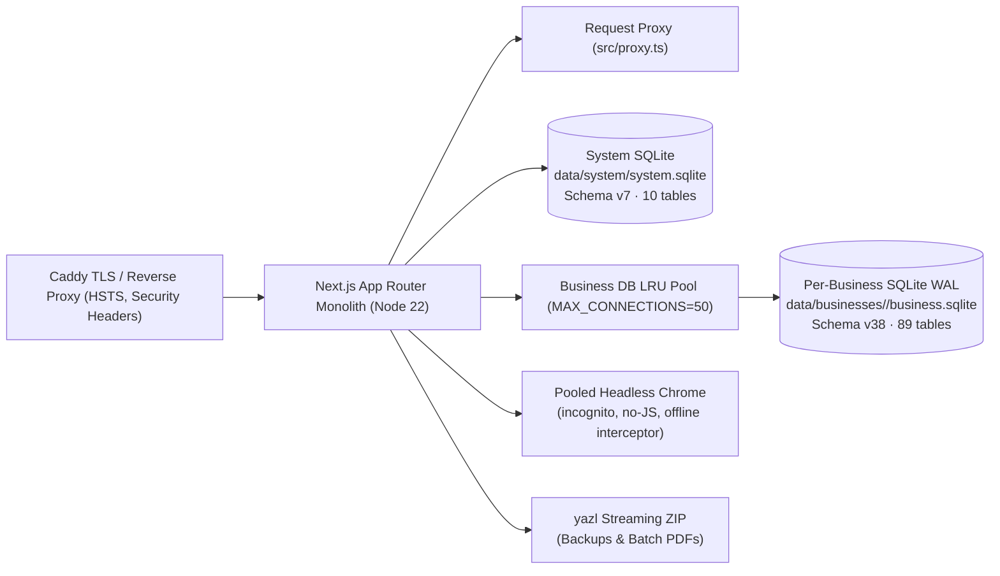

# UAE Manager — Architecture & Domain Specification

**Application:** `modern-erp` v2.7.0 · **Updated:** 14 November 2026 (Sprints 1–4)
**Stack:** Next.js `16.4.3` (App Router), React `19.2.8`, Node `22` (`.nvmrc`), TypeScript `6.0.3`, SQLite (`better-sqlite3` `13.0.3`), Drizzle ORM `0.45.2`, Better Auth `1.7.14`, Tailwind CSS `4.3.3`, Radix UI, `@tanstack/react-table` `^9.2.4`, `@tanstack/react-virtual` `^3.14.26`, `nuqs` `^2.10.3`, `cmdk` `^1.1.1`, `yazl` `^3.3.1`, Puppeteer `^25.7.0`, `@react-pdf/renderer` `^4.6.1`, `@sentry/nextjs` `10.75.2`.

---

## 1. System Topology

UAE Manager runs as a single modular monolith ([next.config.ts](../next.config.ts)) backed by isolated local SQLite files with no external database daemon or separate microservice process.

### Key Architectural Boundaries
- **Core platform (`src/core/`)**: Auth (`better-auth`), sessions, active-user guards, tenant & quota lifecycle (`admin/tenant-service.ts`), business lifecycle & atomic backups (`businesses/`), granular RBAC (`permissions/`), migrations (`db/`), diagnostics, and formatting/logging.
- **Business modules (`src/modules/`)**: Double-entry accounting (`accounting/`), banking/rules/PDCs (`banking/`), customers, suppliers, inventory (items, locations, goods receipts, delivery notes, stock adjustments, valuation), sales & purchase commercial cycles (quotes, orders, invoices/bills, credit/debit notes, receipts, supplier payments), settlements (`settlement/`), shared query helpers (`shared/`), payroll & EOSB/WPS (`payroll/`), UAE VAT & FTA FAF (`tax/`), comparative & drill-down reports (`reports/`), HTML/React-PDF templates (`document-templates/`), Manager.io migration importer (`migration/`), approvals, notifications, and activity logs.
- **Presentation (`src/app/`, `src/components/`)**: Server Components load initial authorized slices directly from SQLite and hand interactive table/form workspaces to modular client components.

---

## 2. Database, Schema & PRAGMA Model

### Multi-Tenant SQLite Split
| Store | Location | Schema Version | Verified Drizzle Footprint | Migration Source |
| :--- | :--- | :---: | :--- | :--- |
| **System DB** | `data/system/system.sqlite` | **7** | 10 tables, 79 columns, 10 indexes | [system.ts](../src/core/db/migrations/system.ts) |
| **Business DB** (per workspace) | `data/businesses/<directoryKey>/business.sqlite` | **40** | 90 tables, 1343 columns, 194 indexes | [business-migrations.ts](../src/core/db/business-migrations.ts) |

- **Migrations are hand-written TypeScript** (no `drizzle-kit`): the migrated database is the source of truth and the Drizzle schema files mirror it for typed queries.
- **Schema verification**: `npm run check:schema` (CI static job) migrates a fresh temporary data directory, seeds a business, and fails if the Drizzle definitions differ from SQLite in tables, columns, indexes (name, column order, unique, partial) or inline UNIQUE constraints, or if foreign keys are violated. `npm run db:verify-schema` runs the same comparison against `ERP_DATA_DIR`.
- **Server-only modules**: every `src/core/db/*.ts` file except the client-shared constants in `account-types.ts` imports `server-only`, so Next.js fails the build if one reaches a client bundle. Plain Node entry points (tests, `db:*` scripts, Playwright fixtures) preload `scripts/server-only-node.mjs`, and `scripts/build-ops.mjs` aliases the package for the ops bundle.
- **Shared SQLite PRAGMAs** ([pragmas.ts](../src/core/db/pragmas.ts)): `applyStandardSqlitePragmas()` enforces `journal_mode = WAL`, `busy_timeout = 5000`, `synchronous = NORMAL` by default (overridable via `ERP_SQLITE_SYNCHRONOUS=FULL`), `foreign_keys = ON`, `temp_store = MEMORY`, `cache_size = -16000`, `mmap_size = 67108864`, and `wal_autocheckpoint = 1000`.
- **LRU Connection Pool** ([business.ts](../src/core/db/business.ts)): Caches up to `MAX_CONNECTIONS = 50` business handles, enforces `MIN_AGE_BEFORE_EVICTION_MS = 10_000` before LRU eviction so in-flight awaits are never truncated, and closes idle handles after `IDLE_TIMEOUT_MS = 300_000` (5 min) after running `checkpointAndOptimizeSqlite()` (`PRAGMA optimize` + `wal_checkpoint(TRUNCATE)`).
- **Super-Admin & Document Immutability Triggers**:
  - `prevent_superadmin_deletion` (`BEFORE DELETE` on `"user"` when `OLD.is_super_admin = 1`) blocks root account removal at the database layer.
  - Posted commercial documents enforce SQLite triggers (e.g. `posted_debit_note_currency_immutable`) preventing currency/exchange-rate mutation after posting.
- **Recent Schema Milestones**:
  - **System v7** (`membership_approval_controls`): adds per-membership `requires_approval` Maker-Checker enforcement toggle.
  - **Business v37** (`roadmap_pillars_1_2_3`): adds `show_on_pdf` on custom field definitions, UAE WPS employee/company fields (`mol_person_id`, `bank_routing_code`, `iban`, `mol_establishment_id`, `wps_bank_routing_code`), PDC clearing accounts & numbering settings, `saved_reports`, and `post_dated_cheques`.
  - **Business v38** (`38_settlement_date_indexes`): composite indexes on `receipts`, `supplier_payments`, and `sales_credit_notes` date/status columns for server-paginated queries.

---

## 3. Security, Access Control & Maker-Checker Approvals

- **Authentication & Requests**: Handled by Better Auth (`src/core/auth/`) and `src/proxy.ts`. `assertActiveUser` rejects suspended or deleted users on mutations; production refuses missing or placeholder secrets and restricts `BETTER_AUTH_TRUSTED_ORIGINS`.
- **Permission Boundaries**:
  - Every business command invokes `assertMutationPermission`, `assertSavePermission`, or `assertBusinessAdministrator` (`src/core/permissions/`).
  - `npm run check:permissions` (`scripts/check-permissions.mjs`) statically verifies coverage across all **160** business command functions.
  - Super-admin workspace quotas (`max_businesses`, `max_users`) are managed in [tenant-service.ts](../src/core/admin/tenant-service.ts).
- **Maker-Checker Approvals** (`src/modules/approvals/` & `src/modules/notifications/`): Supports per-membership `requires_approval`, configurable amount threshold rules, `pending_approval` document states, isolated approval queue transitions, and bi-directional notifications between maker and approver.
- **Content Security Policy (CSP)** ([next.config.ts](../next.config.ts)):
  - Emits strict security headers (`frame-ancestors 'self'`, `base-uri 'self'`, `form-action 'self'`, `worker-src 'self' blob:`, `object-src 'self' blob:`, `frame-src 'self' blob: data:` for Template Studio PDF previews, Sentry ingest allowlist on `connect-src`).
  - `script-src 'self' 'unsafe-inline'` in production (`process.env.NODE_ENV === "production"`), appending `'unsafe-eval'` only in non-production builds for React/Next dev tooling.
  - [next.config.ts](../next.config.ts) also emits `Strict-Transport-Security`, `Permissions-Policy`, `X-Frame-Options`, `X-Content-Type-Options`, and `Referrer-Policy` across application routes, while [Caddyfile](../Caddyfile) layers TLS and default (`?`) fallback `X-Frame-Options`, `X-Content-Type-Options`, and `Referrer-Policy` headers on static/error responses without duplicating headers.

---

## 4. Accounting, Multi-Currency & UAE Regulatory Core

- **Exact Integer Precision**:
  - Monetary amounts are stored as signed minor-unit integers (`*_minor`; e.g., `1` AED = `100` fils; 3-decimal GCC currencies such as BHD/KWD/OMR use `1000` units).
  - Quantities are stored in `*_micros` columns at the app quantity scale of 10,000 (4 decimal places, `QUANTITY_SCALE` in `src/modules/accounting/calculations/money.ts`; despite the column name this is not `1e-6`), paired with `decimal.js` (`decimal.js` `10.6.0`) primitives for exchange conversion, tax splitting, and proportional allocations.
- **Double-Entry Integrity & Lock Dates**: All posted financial documents emit balanced journal entries ($\sum \text{Debits} = \sum \text{Credits}$), verified against GL reconciliation (`src/core/db/reconciliation.ts`). Financial and VAT lock dates guard backdated posting/voiding/edits.
- **Multi-Currency FX**: Unified base-per-foreign conversion model with immutable posted snapshots and base currency fallback via `resolveBaseCurrencyCode()` ([currency-fallback.ts](../src/modules/reports/currency-fallback.ts)).
- **UAE Regulatory & Compliance Features**:
  - **UAE VAT 201 & TRN Validation**: 15-digit UAE TRN checksum validation ([trn-validation.ts](../src/modules/tax/trn-validation.ts)), supply emirate attribution, reverse charge handling, VAT periods/adjustments/snapshots/audit trail, and FTA Audit File (**FAF**) export (`src/modules/tax/faf-service.ts`).
  - **Payroll & WPS**: UAE EOSB gratuity computation, pay runs, payslips + GL posting, and MOHRE **WPS `.SIF`** file generation (`src/modules/payroll/services/wps-service.ts`).
  - **Treasury & Banking**: Bank rules auto-categorization, statement reconciliation, and Post-Dated Cheques (**PDC**) lifecycle (`held -> deposited -> cleared | bounced | cancelled`) with clearing GL accounts (`acct-pdc-receivable-1120`, `acct-pdc-payable-2020`).
  - **Migration**: Universal Manager.io `.manager` backup inspector and business importer (`src/modules/migration/manager-importer.ts`).

---

## 5. Performance, Streaming Exports & PDF Pipelines

- **Server-Driven Pagination & Filter State**:
  - Shared `nuqs/server` loaders ([list-query-params.ts](../src/lib/list-query-params.ts)) and SQLite query builders ([list-query-helpers.ts](../src/modules/shared/list-query-helpers.ts)) drive server pagination (`DEFAULT_LIST_PAGE_SIZE = 50`, `MAX_LIST_PAGE_SIZE = 200`), multi-column sorting, and `LIKE ... ESCAPE '\'` escaping for Customers, Suppliers, Sales Invoices, Purchase Invoices, Receipts, and Supplier Payments.
  - Legacy short URL status links (e.g., `?status=unpaid` from Overview cards) normalize cleanly into canonical tokens (`payment:open`).
- **Overview Tab SSR Deferral** ([overview/page.tsx](../src/app/b/[businessId]/overview/page.tsx)): Initial Financial view skips chart/aging/cash-flow runway calculations; Chart view skips financial KPI and recent transaction queries.
- **Streaming ZIP Archives** ([streaming-zip.ts](../src/lib/streaming-zip.ts)):
  - Powered by `yazl` streaming directly into Web `ReadableStream<Uint8Array>` with consumer backpressure (`output.pause()` / `output.resume()`), `AbortSignal` early cancellation, filename sanitization/deduplication (`deduplicateArchiveFilename`), and once-only temp file cleanup.
  - Used by both atomic business SQLite `.backup()` exports ([backup-service.ts](../src/core/businesses/backup-service.ts)) and batch PDF downloads ([batch-pdf/route.ts](../src/app/api/businesses/[businessId]/documents/[documentType]/batch-pdf/route.ts), capped at 100 documents).
- **Pooled HTML-to-PDF Rendering** ([browser-pool.ts](../src/modules/document-templates/html-templates/browser-pool.ts) & [render.ts](../src/modules/document-templates/html-templates/render.ts)):
  - Maintains a warm Puppeteer browser singleton with `MAX_CONCURRENT_RENDERS = 4`, `IDLE_CLOSE_MS = 60_000` (`.unref()` timer), and `MAX_RENDERS_BEFORE_RECYCLE = 100`.
  - Each render opens an isolated incognito browser context with `page.setJavaScriptEnabled(false)`, aborts non-local network requests (`data:`/`about:`/`blob:` only), and enforces a `15_000ms` timeout.

---

## 6. Build Isolation & Domain Test Architecture

### Isolated Validation TypeScript Configs
- [tsconfig.json](../tsconfig.json) scopes `"include"` explicitly to active source, test, script, root config, and `.next/` generated types, excluding `.next-validate` to avoid redundant directory scans and prevent Next.js validation builds from mutating the shared config.
- [tsconfig.validate.json](../tsconfig.validate.json) extends `./tsconfig.json` and includes `.next-validate/types/**/*.ts`. Whenever `NEXT_DIST_DIR=.next-validate`, [next.config.ts](../next.config.ts) sets `typescript.tsconfigPath = "tsconfig.validate.json"`.

### Domain-Organized `tests/` Tree
| Directory | Coverage Focus | Runner / Config |
| :--- | :--- | :--- |
| `tests/unit/` | Pure math, FIFO allocation, CSP/config guards, TSV grid & UI helpers | `npm run test:unit` |
| `tests/accounting/` | GL posting, multi-currency FX, VAT/FAF, payroll/WPS, PDC, reports | `npm run test:accounting` |
| `tests/platform/` | Auth, RBAC, quotas, approvals, activity logs, backups, PDF pool | `npm run test:platform` |
| `tests/integration/` | Multi-module commercial lifecycles, audits, Manager.io migration | `npm run test:integration` |
| `tests/e2e/` | Playwright acceptance, pillars, hardening & Sprint 2/3 browser suites | `npm run test:e2e` / `playwright*.config.ts` |

- `npm test` runs all 4 Node test domains via native glob discovery (`"tests/unit/**/*.test.ts"` … `"tests/integration/**/*.test.ts"`) inside isolated temp directories ([scripts/test-isolation.mjs](../scripts/test-isolation.mjs)) so customer SQLite files in `data/` are never touched.
