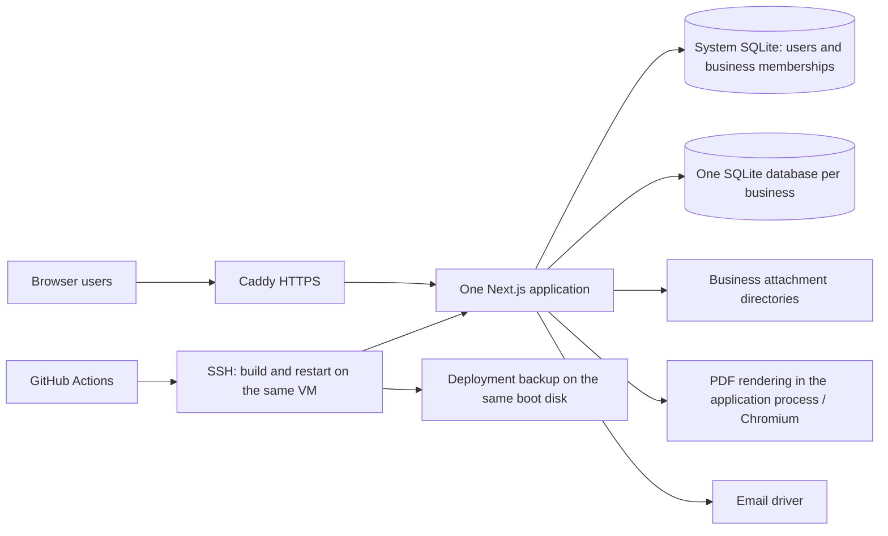
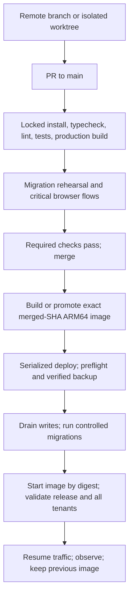

# Ledgerly ERP — architecture and operational review

**Verified on:** 25 October 2026 (UTC). **Audience:** owner and maintainers. **Scope:** source, local checks, GitHub, and read-only production inspection. **Expected rollout:** a few businesses and 5–10 users.

**Handling:** this report describes unresolved security weaknesses. Keep it private until containment and remediation are complete. It was created locally; it has not been committed, pushed, or published.

> **Implementation follow-up — 26 October 2026:** The findings below describe the pre-fix state at `add15e63b846a04fb6a46e38fdd71f74392bf3d5`. Production now runs verified release `32df273e5eeecec3db15f95bd8ba8d0f1cc1cd93`. Read the [hardening outcome and remaining tasks](HARDENING_OUTCOME_2026-10-26.md) for remediation, rollout incidents, current access and verification evidence. The real-data backup remains tracked/public under the owner's instruction to change ignore rules only.

## 1. Decision and immediate priorities

**Historical findings:** this section records the 25 October baseline, not current production defects. Consult the [implementation outcome](HARDENING_OUTCOME_2026-10-26.md), [completed operational checks](TESTING_PHASE_OPERATIONS_2026-10-26.md) and [testing plan](NEXT_STEPS.md) for current status and owner-deferred work. Oracle/Sentry read-only access is now configured; this review is retained as audit evidence rather than rewritten to erase its original findings.

**Keep the Next.js modular monolith and per-business SQLite databases for this rollout. A database rebuild, PostgreSQL migration, Kubernetes, Redis, and microservices are not justified by the current load.** The important work is enforcing authorization consistently, fixing accounting state transitions, making recovery real, and deploying a verified release safely.

The application has useful foundations: physical tenant database separation, foreign keys, transactional posting, integer money helpers, decimal exchange-rate calculations, migrations, and a substantial passing test suite. These do not yet make it ready for unrestricted onboarding. The audit reproduced permission and accounting defects, confirmed a public real-data backup, and found a known default authentication secret in production.

| Priority | Finding | Required outcome |
|---|---|---|
| **P0 — immediate containment** | Real Manager.io business backup is tracked in the public repository. The owner confirmed it contains real data used by the owner and friends. | Restrict access; coordinate history cleanup; assess affected information and any embedded credentials. |
| **P0 — immediate containment** | Production uses the publicly known Compose fallback authentication secret. A runtime `.env` containing the setup key is also present in the image. | Replace compromised/default secrets, invalidate affected sessions, exclude secret files from builds, and rebuild. |
| **P1 — before wider onboarding** | A sales member without create/post permissions can reach create-and-post through the save action. | Enforce action permissions at every mutation boundary and in domain services. |
| **P1 — before wider onboarding** | Payroll can save a posted payslip without a journal; AP aging omits debit notes; EOSB rounds prematurely. | Repair state transitions and shared financial calculations, then add regression cases and reconciliation. |
| **P1 — before wider onboarding** | Backups are deployment-triggered on the same disk; no offsite recovery or restore drill was demonstrated. | Scheduled, verified offsite backups and a measured restore procedure. |
| **P1 — before wider onboarding** | Deployment uses moving `main`, has no serialization, no fail-fast shell, weak readiness, and no automatic safe rollback. | Deploy the tested immutable release, serialize migrations/deployment, verify tenant readiness, retain the prior release. |
| **P1 — before wider onboarding** | Request-supplied origins become trusted; restricted users can see overview financial summaries. | Fixed production origin allowlist and permission-filtered dashboard reads. |
| **P1 — before wider onboarding** | Dependency audit reports actionable framework advisories; production email currently falls back to simulated success. | Patch and retest dependencies; configure verified email delivery or disable sending visibly. |
| **P2 — next hardening cycle** | Imports, PDFs, exports, synchronous queries, logging, build cache, and connection eviction lack sufficient bounds. | Resource limits, durable jobs, bounded queries, and explicit connection leases. |

Priority reflects this deployment's exposure and business impact, not an independently assigned CVSS score. No exploitation, customer-data corruption, or prior unauthorized access was established.

## 2. What was actually verified

The dossiers were treated as claims to check, not as authoritative runtime evidence. Source review followed authentication, business selection, document saves/posting, reports, imports, backup/export, email/PDF, migration startup, and deployment. Live database inspection used read-only SQLite connections and `query_only`; application initialization and migrations were not invoked against production.

| Area | Verified observation | Limit |
|---|---|---|
| Local / GitHub / server revision | All pointed to `add15e63b846a04fb6a46e38fdd71f74392bf3d5`; server checkout was clean. | Working-tree changes listed below were excluded from application conclusions. |
| GitHub access | Connector access works; authenticated CLI account has repository administration/push permissions. Repository is public. | No settings, secrets, branches, or workflows were changed. |
| Production access | SSH works using the existing local key with strict host-key checking. Noninteractive administrative inspection works. HTTPS health returned 200 with normal certificate verification. | No production write tests or authenticated user workflow tests. |
| Runtime | Ubuntu 24.04.5 LTS, ARM64, 2 CPUs, approximately 12 GiB RAM, 100 GB boot block device. Node 22.23.4; Next 16.3.5; SQLite 3.53.4. | OCI shape, billing tier, volume performance, IAM, and backup policies require control-plane access. |
| Databases | One system database and six business databases; all seven passed `quick_check` and had zero `foreign_key_check` violations. | This is structural validation, not proof of accounting correctness or a full restore. |
| Business data volume | Two journal entries / five journal lines total; both journals balanced and had at least two lines. One sales invoice; no purchase invoices or inventory movements. | This dataset is too small to establish production performance or broad accounting correctness. |
| CI | Latest ten inspected main push runs succeeded. Latest run verified lint/typecheck/tests and built/deployed the app. | No restore drill, browser E2E suite, or migration rehearsal in that pipeline. |
| Local verification | 335 tests passed, none failed/skipped; lint passed. | Full local typecheck failed on existing generated `.next/dev/types` syntax; see section 12. |

The latest inspected [GitHub Actions run](https://github.com/MuhammadRayyan/erp-software-2.0/actions/runs/40050980059) ran on 24 October, approximately 01:42–01:47 UTC. The running image digest was `sha256:6ef2dc0c0004c884b44ab7a2e533725bf91c84d11a065f8354c0088e131bff86`, matching the deployment evidence. The container had zero restarts. There is no application-reported Git SHA or image revision label to make future provenance checks as straightforward as they should be.

Existing local changes were `next-env.d.ts` and the two untracked dossier files. Application code, production configuration, databases, GitHub settings, and running services were left unchanged. Only this report and documentation verification notices were added by the audit.

## 3. Architecture and technology stack



Versions resolved from the lockfile, rather than package manifest lower bounds:

| Component | Audited version / role |
|---|---|
| Next.js / React | 16.3.5 / 19.2.8; App Router, Server Components, Server Actions, route handlers |
| Better Auth | 1.6.26; authentication against system SQLite |
| better-sqlite3 / Drizzle | 13.0.3 / 0.45.2; synchronous SQLite driver and schema/query layer |
| decimal.js | 10.6.0; decimal conversion calculations |
| TypeScript / Tailwind | 6.0.3 / 4.3.3 |
| Sentry | 10.74.0; error instrumentation, with hardcoded fallback DSN |
| Handlebars / Nodemailer | 4.7.9 / 9.1.1; templates and email |
| Puppeteer | 25.7.0; optional Chromium-based PDF rendering alongside React PDF |
| Runtime / packaging | Production Node 22, Docker standalone build, Caddy; local Node 24.15.0 |

Maintain the monolith but strengthen internal boundaries: authenticated actor context → domain command → one business transaction → journal/inventory/tax/audit effects → durable outbox. Keep reads separately optimized. This gives most of the reliability benefit without introducing network services.

Choose one supported Node major and one package manager for local development, CI, and production, with explicit `engines`, package-manager version, and one lockfile. Current production/CI use npm and Node 22 while documentation describes Bun/Node 24 and both npm/Bun locks exist. Node 22 and 24 are maintained LTS lines at the review date; upgrading runtime is a planned compatibility change, not an emergency rewrite. [Node release schedule](https://nodejs.org/en/about/previous-releases)

The real production definition is [docker-compose.yml](<D:/Projects/Codex/ERP Software 2.0/docker-compose.yml>) with the [Dockerfile](<D:/Projects/Codex/ERP Software 2.0/Dockerfile>). [compose.prod.yaml](<D:/Projects/Codex/ERP Software 2.0/compose.prod.yaml>) is misleading: it invokes a development Dockerfile and `pnpm dev`, references absent pnpm inputs, and contains development watch configuration. Remove or replace that stale entry point after choosing the supported deployment procedure.

## 4. Security and multi-tenant isolation

### 4.1 Public business backup — confirmed P0

The tracked root file [manager_backup_file.manager](<D:/Projects/Codex/ERP Software 2.0/manager_backup_file.manager>) is 3,727,360 bytes and exists at the same revision currently published in the public repository. The owner explicitly confirmed it is real Manager.io data. Its content was not opened or reproduced during this audit. The file's last modifying commit was `65490a9f`; the current Git blob is `0226c902f38ed13744389f4885ce34538d1c0762`.

Recommended containment sequence:

1. Make the repository private promptly and stop sharing public copies. Before subsequent deployments, provide the server a read-only repository credential or move to authenticated image pulls; its current fetch may depend on public access.
2. Preserve a private authorized original. Remove the file from the current tree and rewrite affected history using GitHub's documented sensitive-data procedure, coordinating collaborators' clones and references.
3. Inspect the original privately for business/person information, attachments, and any embedded credentials. Rotate credentials if present. Assess any notification obligations with appropriate advice; the audit cannot establish who downloaded the file.
4. Replace it with synthetic fixtures; add ignore rules and automated rejection of business database/archive formats in commits and build contexts.

Making a repository private does not retract existing downloads or public forks. Removing only the current file does not remove historical copies. GitHub documents both limitations and the cleanup process. [Visibility changes](https://docs.github.com/en/repositories/managing-your-repositorys-settings-and-features/managing-repository-settings/setting-repository-visibility), [sensitive-data removal](https://docs.github.com/en/authentication/keeping-your-account-and-data-secure/removing-sensitive-data-from-a-repository)

### 4.2 Production authentication secret and image contents — confirmed P0

The live process's `BETTER_AUTH_SECRET` equals the fallback literal committed in Compose. Equality was checked without reporting the secret value. This must be treated as a known authentication-signing secret; its exact exploitation consequences depend on Better Auth's session/token paths, and no session-forgery test was performed.

Production `/app/.env` exists inside the running image and includes `SETUP_KEY`. The build copies the source tree, and [.dockerignore](<D:/Projects/Codex/ERP Software 2.0/.dockerignore>) does not exclude `.env` files. The host `.env` was mode 0644. There is no evidence that the setup key itself was publicly downloaded, but image copies and build caches unnecessarily contain it.

Generate a strong runtime secret, fail startup if missing or equal to a placeholder, rotate the setup key, and invalidate affected sessions. Do not keep a known-exposed old secret in a rotation grace period. Exclude `.env*` except an intentional example, private keys, credentials, and real datasets from the build context; assert their absence from the final image. Inject runtime secrets separately and use BuildKit secret mounts only when a build truly needs credentials. Restrict host file permissions and clean obsolete secret-bearing images/caches after a verified release and recovery copy exist. [Better Auth setup](https://better-auth.com/docs/installation), [Docker build secrets](https://docs.docker.com/build/building/secrets/)

### 4.3 Action-level permissions — reproduced P1

[Sales save actions](<D:/Projects/Codex/ERP Software 2.0/src/modules/sales-invoices/actions.ts:26>) call `requireModule("sales")`, then pass user-controlled save intent to `createInvoice` or `updateInvoice`. The separate post action has a stronger guard, but inline save-and-post does not. The service checks business membership, not create/edit/post permission.

A disposable fixture established `moduleView=true`, `createPermission=false`, `postPermission=false`, yet `createInvoice(..., "post")` created a posted document. This is a service-level reproduction combined with a traced Server Action path, not a production HTTP exploit. It shows that hiding buttons is insufficient. Payroll save actions have a similar module-only pattern.

Require create or edit permission for saves and post permission when posting is requested. Recheck authorization in the domain command, using a server-derived actor and business scope. Cover duplicate, batch, conversion, import, attachment, email, void, and export paths. Add negative tests for each role/action pair, including same-tenant restricted users, different tenants, suspended users/businesses, and forged business IDs. [Permission guards](<D:/Projects/Codex/ERP Software 2.0/src/core/permissions/require-module.ts>)

### 4.4 Request origins and dashboard disclosure — confirmed code defects

[getTrustedOrigins](<D:/Projects/Codex/ERP Software 2.0/src/core/config/app-url.ts:57>) adds the incoming `Origin` header to its trusted set. A pure function check confirmed an arbitrary origin is accepted. It also derives trusted origins from host/forwarded headers. Replace this with a fixed environment-specific HTTPS allowlist and controlled proxy trust. Cookie settings and other defenses affect practical CSRF exploitability; an end-to-end CSRF exploit was not attempted.

The [overview page](<D:/Projects/Codex/ERP Software 2.0/src/app/b/[businessId]/overview/page.tsx:63>) loads invoice data and renders KPI/financial summaries regardless of the relevant financial-module permission flags. Overview is not mapped to a restrictive module by the route guard. A member restricted to another module can consequently reach business financial summaries. Filter both queries and rendered sections by explicit permissions. This concerns disclosure within a business; cross-business disclosure was not demonstrated.

### 4.5 SQLite isolation is useful but shares an application trust boundary

The actual layout is:

```text
/opt/modern-erp/data/system/system.sqlite
/opt/modern-erp/data/businesses/<directoryKey>/business.sqlite
/opt/modern-erp/data/businesses/<directoryKey>/attachments/...
```

Business IDs and directory keys are distinct. Path validation, membership checks, separate files, and per-connection foreign-key enforcement are positive controls. However, one process and one OS identity can open every tenant database. A compromised process or incorrectly scoped service can still cross tenants.

[getBusinessDb](<D:/Projects/Codex/ERP Software 2.0/src/core/db/business.ts:93>) accepts an optional user ID; omitting it bypasses membership checking. Some callers rely on an earlier guard, making this easy to misuse during future changes. Require an authenticated, authorized business context for normal reads/writes. Put administrative and maintenance access behind a separate explicit API with audit events. Align suspension checks across layouts, actions, services, and database access. Do not treat UUIDs, hidden navigation, or a database filename as authorization.

The app runs as root with unrestricted access to mounted data. Use a dedicated non-root UID, restrictive data/secret permissions, dropped capabilities, no-new-privileges, an appropriate writable temp directory, and measured resource limits. Validate Chromium under the selected sandbox configuration instead of silently relying on root plus `--no-sandbox`.

## 5. Database lifecycle, migrations, and consistency

The system database has 10 tables and 22 indexes, with migrations 1–6 recorded. Each business database has 84 tables and 279 indexes, with 36 migration records: baseline 0 plus versions 1–35. All businesses inspected were at the same current version.

### 5.1 Strengths to preserve

- WAL, foreign keys, busy timeouts, per-migration transactions, and rejection of unknown newer schema versions are implemented.
- Posting validates balanced, nonnegative safe-integer journal values, account existence/activity, and a minimum of two lines. Source uniqueness and reversal mechanisms reduce accidental duplication.
- Online SQLite backup is already used for the database portion of native business exports.
- Existing migration/check scripts provide a useful starting point for an explicit release lifecycle.

### 5.2 Startup can become falsely healthy — reproduced P1

[getSystemSqlite](<D:/Projects/Codex/ERP Software 2.0/src/core/db/system.ts:14>) assigns the global connection before running migrations. If migration fails, that connection remains cached. In a temporary database marked schema version 999, the first initialization correctly threw an incompatible-version error; the next initialization returned the cached handle and `SELECT 1` succeeded.

The [health route](<D:/Projects/Codex/ERP Software 2.0/src/app/api/health/route.ts:13>) only requires that system query. A process can therefore appear healthy after failed initialization, and unhealthy tenant databases are not tested at all. Construct and migrate a temporary handle, publish the singleton only after validation, and close/reset it on error. Record initialization failure explicitly.

Separate liveness from readiness. Readiness should confirm expected system/tenant schema versions, migration completion, access to required directories, and release identity. Run bounded integrity/read-write checks in a deployment verifier, not a full database scan on every health request. Keep the external health response minimal; protect detailed version, memory, and database error diagnostics.

### 5.3 Move migrations out of normal request handling

[Business database opening](<D:/Projects/Codex/ERP Software 2.0/src/core/db/business.ts:72>) creates missing directories/files and runs migrations on each cold connection. A missing mount or deleted file can be mistaken for a new empty database, and an inactive tenant's failure may first surface during a user request after deployment.

Use `fileMustExist` or equivalent for established tenants. Separate creation/provisioning from opening an existing business. Package and execute a migration CLI for all registered databases as a controlled release step. Add migration checksums and a single migration/deployment lock; per-database transactions do not serialize independent application processes or make a fleet migration atomic.

Test upgrades from representative old snapshots and deliberately injected failures. Record per-tenant status and stop readiness for tenants that did not migrate. Use expand → backfill → switch reads/writes → contract over separate releases for destructive changes. Do not drop or rewrite important tables during ordinary app startup.

The current rejection of newer schema versions means an old image may refuse a database migrated by a new image even when the SQL change was additive. Safe rollback needs explicit compatible schema ranges and tests, or a tested forward-fix/restore plan. Database restore after users resume writing can lose new transactions; it must not be an automatic consequence of an HTTP health failure.

### 5.4 Connection pool and durability

The pool has a soft cap of 50, a five-minute idle timer, and a ten-second minimum age before eviction. These are elapsed-time heuristics, not active-operation leases. A request holding a connection across a long `await` can have it closed; if all connections are recent, the pool can exceed the cap. Add acquire/release tracking or constrain handles to synchronous transaction scopes; idle eviction should require zero active leases.

Business connections use `synchronous=NORMAL`. WAL with NORMAL preserves database consistency but can lose recently acknowledged transactions after power/OS failure. For financial writes, benchmark `FULL` and prefer its stronger commit durability if the measured cost is acceptable. Busy timeouts do not create parallel writers or prevent application event-loop blocking. [SQLite durability settings](https://www.sqlite.org/pragma.html#pragma_synchronous), [WAL behavior](https://www.sqlite.org/wal.html)

### 5.5 Cross-database operations and import publication

Business creation/import touches the system registry, a tenant database, and attachments. These resources do not share one atomic transaction. Some failure cleanup removes files without fully undoing a committed registry entry. Currency changes can also span tenant/system state.

Manager.io import registers the business before completion and temporarily uses `synchronous=OFF` / `journal_mode=MEMORY`. Failure handling restores pragmas but can leave an incomplete registered business. Native restore inserts registry records directly without the ordinary owner/quota path; Manager import also omits enforced quota. All current live businesses had owners, so this is a future-path defect rather than an observed ownerless production tenant. [Manager importer](<D:/Projects/Codex/ERP Software 2.0/src/modules/migration/manager-importer.ts:192>), [business creation](<D:/Projects/Codex/ERP Software 2.0/src/core/businesses/business-service.ts>)

Introduce `provisioning → validating → active` lifecycle states, with durable error status and cleanup/retry. Import into a staging directory, validate schema/integrity/financial totals, restore safe pragmas, then publish. Reserve quota atomically in the system database and use one owner-assignment path. Add reconciliation for orphan directories and missing registered databases. Do not rebuild the production database merely to obtain this behavior; use staged migrations and verified imports.

## 6. Financial precision and accounting behavior

### 6.1 Good primitives, incomplete end-to-end guarantees

[money.ts](<D:/Projects/Codex/ERP Software 2.0/src/modules/accounting/calculations/money.ts>) uses scaled integer/BigInt parsing, checked conversion to JavaScript safe integers, and explicit rounding. Quantities use 10,000 units per whole quantity. [Currency conversion](<D:/Projects/Codex/ERP Software 2.0/src/modules/currency/conversion.ts>) uses decimal arithmetic, and [inventory valuation](<D:/Projects/Codex/ERP Software 2.0/src/modules/inventory/inventory-valuation.ts>) uses integer calculations with residual handling. Preserve these choices.

Precision can still be lost outside those helpers: unchecked JavaScript sums can overflow the safe range, payroll rounds intermediate values, and cash-basis reporting explicitly uses SQLite `REAL`. SQLite integer storage alone does not guarantee exact application arithmetic.

Standardize checked minor-unit addition/multiplication, input bounds, signed rounding, currency precision, exchange-rate precision, and residual allocation across modules. Keep decimal values as strings or scaled integers across serialization. Document exactly where rounding occurs; reconcile document totals, journal totals, tax totals, and report totals rather than assuming independently rounded calculations agree.

### 6.2 Payslip can be posted without accounting — reproduced P1

[savePayslip](<D:/Projects/Codex/ERP Software 2.0/src/modules/payroll/services/payroll-service.ts:688>) accepts `documentStatus`, but posting runs only when `autoPost` is true. A disposable test saved `documentStatus="posted"`, `autoPost=false`; the row was posted, its `journal_entry_id` was null, and no journal existed. Editing an already posted payslip through this path can also leave accounting stale.

Make status a server-owned state machine. A post command must validate permissions, lock dates, balanced journal generation, and document/journal linkage inside one transaction. Prevent ordinary edits from silently replacing the financial meaning of posted documents. Use reversal/repost or explicit immutable revisions with a complete audit trail.

### 6.3 AP aging excludes debit notes — reproduced P1

[getAccountsPayable](<D:/Projects/Codex/ERP Software 2.0/src/modules/reports/report-service.ts:201>) subtracts supplier payments but does not include debit notes. The purchase-invoice detail calculation does include them. A posted AED 100 purchase invoice with an AED 20 debit note showed AED 80 in the detail balance and AED 100 in AP aging.

Create a shared outstanding-balance calculation for invoice details, statements, aging, dashboards, and settlement validation. Test combinations of debit/credit notes, partial payments, reversals, FX carrying amounts, and reporting cut-off dates. Reconcile the subledger to control accounts as a release gate.

### 6.4 EOSB rounding and date validation — reproduced P1

The [EOSB calculator](<D:/Projects/Codex/ERP Software 2.0/src/modules/payroll/services/eosb-calculator.ts:103>) rounds daily salary before multiplying days. At AED 1,000 monthly basic salary and 365 net service days, it returned AED 699.93 for the first-year gratuity instead of AED 700.00 when rounding at the final minor-unit boundary. It also accepted the impossible date `2025-02-31` through date normalization.

Use strict calendar validation and decimal/rational calculations with final-boundary rounding. Establish accountant-reviewed examples for partial years, leap years, unpaid leave, five-year transitions, caps, and leave encashment. Do not imply the calculator covers every UAE employment category or alternative savings arrangement. The official overview is a starting point for validating scope, not a certification of this implementation. [UAE end-of-service guidance](https://u.ae/en/information-and-services/jobs/employment-in-the-private-sector/end-of-service-benefits-for-employees-in-the-private-sector)

### 6.5 Audit history and regulatory claims

Journal replacement can delete/recreate earlier lines. Activity logging catches and suppresses failures, so it cannot serve as a mandatory tamper-resistant financial audit trail. Keep mandatory financial events in the posting transaction, with actor, prior/new version or reversal reference, and correlation ID. Separate them from disposable operational logs. [Posting service](<D:/Projects/Codex/ERP Software 2.0/src/modules/accounting/services/posting-service.ts>), [activity logging](<D:/Projects/Codex/ERP Software 2.0/src/modules/activity-log/activity-log-service.ts>)

VAT period snapshots are JSON records; no cryptographic signing was verified. The dossier's “signed snapshots” wording is unsupported. The reviewed source/dependencies also did not contain an active PINT-AE/Schematron submission or validation implementation supporting the documentation's e-invoicing claims. Historical plans and schema fields are not evidence of a working integration.

Before claiming UAE e-invoicing readiness, define scope against current official requirements, integrate an appropriate accredited service provider, validate generated documents, persist submissions/acknowledgments, and test retry/rejection workflows. Verify regulatory applicability and dates separately when planning launch. [UAE Ministry of Finance ASP information](https://mof.gov.ae/en/about-us/initiatives/einvoicing/einvoicing-accredited-service-providers-asps/), [FTA e-invoicing information](https://tax.gov.ae/en/content/uae.einvoicing.aspx)

## 7. Backups and recovery

### 7.1 Observed position

Live application data occupied approximately 12 MB. Backups occupied approximately 3 MB under `/home/ubuntu/backups`, on the same boot disk. The latest observed archive was `backup_20261024_014700.tar.gz`, roughly 42 hours old. Its archive listing was readable and included attachments and six database files; the live system now has seven databases. This establishes that the backup predates some current state, not that the archive was defective when created.

No application backup cron/timer was found. OCI backup policies were not inspectable with available credentials. No offsite copy or successful full restore was demonstrated. Loss of the VM/disk could therefore affect both application data and the only verified backups.

The workflow stops the application before making its tar archive, which is safer than tarring live mutable SQLite files. However, it lacks fail-fast handling and is tied to deployments. The operational runbook separately suggests tarring a running data directory; that is unsafe as a general online SQLite backup procedure. Use SQLite's backup API or a deliberately quiesced consistent snapshot. [SQLite online backup](https://www.sqlite.org/backup.html)

Native business export already calls the SQLite backup API. Its attachments and metadata are collected separately, so the export is not guaranteed to represent one consistent database-plus-files instant. Add a manifest with checksums, snapshot identity, database/schema versions, attachment list, and lifecycle metadata. [Backup service](<D:/Projects/Codex/ERP Software 2.0/src/core/businesses/backup-service.ts:59>)

### 7.2 Recommended recovery targets explained

**Recovery point objective (RPO)** is how much recent work might be lost. **Recovery time objective (RTO)** is how long the service may take to return after a failure.

For this small financial application, use a proposed **RPO of at most 15 minutes** and **RTO of at most one hour** after a single-VM failure, provided a replacement VM is available. These are engineering targets, not capabilities established today. At present, the latest verified backup could lose roughly 42 hours of changes; recovery duration is unknown.

Start with a working offsite backup and a restore drill before promising either target. Then use roughly five-minute snapshot/upload cycles, with monitoring of the last fully restorable offsite recovery point. A nominal 15-minute schedule can exceed a 15-minute RPO once upload time and failures are included.

### 7.3 Implementation design

1. Create a snapshot coordinator using SQLite backups plus a versioned attachment manifest. Briefly coordinate writes/provisioning where needed to keep the system registry, tenant inventory, tenant snapshots, and files consistent. Copy/upload after releasing the short barrier.
2. Encrypt in transit and at rest; place copies outside the VM/disk in private object storage. Give the uploader narrow permissions and prevent normal app credentials from deleting protected backup history where possible.
3. Keep a bounded intraday window, daily copies, and longer weekly/monthly copies under an explicit business retention policy. Monitor failed uploads, backup age, missing tenants, and unexpectedly large/small backups.
4. Restore into an isolated staging location: validate manifests, `integrity_check`, foreign keys, migration history, journal balances, tenant ownership, permissions, attachments, and representative reports. Compare restored counts/totals to the backup manifest.
5. Run a full replacement-host recovery drill and record elapsed time, DNS/TLS steps, secrets retrieval, last recovered transaction, and operator actions. Repeat regularly and after backup/schema changes.

Litestream is a possible later improvement for frequent SQLite replication, but each database is replicated independently and attachments/system-to-tenant consistency still need handling. Current configuration differs from older examples, including the v0.5 replica model. Pin the version and test dynamic tenant discovery and restore before adoption. It is not a substitute for restore drills or a complete application snapshot. [Replication configuration](https://litestream.io/reference/replicate/), [restore behavior](https://litestream.io/reference/restore/), [version migration notes](https://litestream.io/docs/migration/)

## 8. CI/CD and remote development

### 8.1 What works today

The [workflow](<D:/Projects/Codex/ERP Software 2.0/.github/workflows/deploy.yml>) runs checks for pushes and PRs, then deploys on a push to `main`. GitHub has the expected server connection secret names configured. The latest run passed and the server is on the expected revision. This already supports the basic remote-edit → push → merge → deploy intent.

However, `main` is unprotected, repository rulesets and environments are empty, and direct pushes can deploy. Checks include lint, TypeScript, and unit tests, but the production build occurs only later on the live VM. A branch push and PR can also produce duplicate verification runs.

### 8.2 Concrete failure modes

| Current behavior | Failure mode | Improvement |
|---|---|---|
| Fetch/reset to `origin/main` during deployment | A queued run can deploy a later commit that its own job did not verify. | Build and deploy the event's exact SHA/digest. |
| No workflow concurrency group or host lock | Concurrent releases can race over checkout, images, backups, and containers. | Serialize deployment and migrations; also use a host lock. Do not cancel a deployment mid-migration. |
| SSH script lacks fail-fast settings | Build, stop, or backup failure may be followed by later commands and a misleading final success. | Explicit fail-fast shell, checked critical steps, clear terminal state. |
| Build on the production VM | Build CPU/memory/disk competes with users; a new build can fail only after merge. | Build/test the ARM64 release in CI and push an immutable registry image. |
| Stop/start single app | Requests can fail; Caddy retry settings do not guarantee transparent POST replay. | Short, measured drain/maintenance window initially; compatibility-aware traffic switching later. |
| Health only runs a system `SELECT 1` | Tenant migration/schema failures and a wrong release can pass deployment. | Release identity plus explicit schema/readiness validation. |
| Image prune before health verification | Rollback artifacts can become unavailable. | Keep prior known-good digests and prune only by retention policy. |
| Missing SSH secrets skip the deploy step | A green job may contain no deployment. | Fail clearly if required deploy configuration is missing. |
| Floating action/base-image tags; no SSH fingerprint input | Supply-chain changes or host identity mistakes are harder to detect. | Pin reviewed action SHAs/image digests and the server host fingerprint. |

In the inspected run, the stop/start commands completed in approximately 1.5 seconds and health passed about nine seconds after stopping began. This does not measure user-visible availability or prove zero downtime. Caddy's `lb_try_duration` is a retry budget; retry policy and request method/body matter. [Caddy reverse proxy behavior](https://caddyserver.com/docs/caddyfile/directives/reverse_proxy)

### 8.3 Recommended merge-to-deploy workflow



Use short branches and reviewable PRs. Require checks and resolved review conversations on `main`; restrict bypass and deployment secrets. An environment restricted to `main` can still deploy automatically after merge: a manual approval on every routine release is unnecessary for the desired workflow. Add an explicit controlled path for destructive migrations. Verify available private-repository protection features against the account plan when changing visibility. [Protected branches](https://docs.github.com/en/repositories/configuring-branches-and-merges-in-your-repository/managing-protected-branches/about-protected-branches), [deployment environments](https://docs.github.com/en/actions/reference/workflows-and-actions/deployments-and-environments), [workflow concurrency](https://docs.github.com/en/actions/how-tos/write-workflows/choose-when-workflows-run/control-workflow-concurrency)

Build with a frozen dependency install and fail if the lockfile is missing. Test the native SQLite addon and Chromium on ARM64; an x86-only CI pass is insufficient. Publish an image with commit/version/schema labels and a dependency inventory, then deploy by digest. Give the server pull-only registry credentials and the automation narrowly scoped SSH privileges. Preserve an emergency manual recovery procedure.

### 8.4 Minimal downtime without premature high availability

For 5–10 users, a predictable short maintenance/drain window is preferable to claiming seamless availability that has not been tested. Build and pull before the window, verify disk and backup, block new mutations, finish in-flight writes, migrate, start, validate, and reopen. Initially target a measured 10–30-second routine release window; larger migrations may require staged backfills or a longer announced window. This is a target, not a measured guarantee.

Later, two app containers can support controlled traffic switching only after both versions understand the same schema, sessions, Server Actions, job ownership, and cache behavior. Keep SQLite on local storage; do not mount the same WAL database over a network filesystem to add replicas. Serialize migrations and initially keep one active writer application.

Next.js rolling deployments also need retained static assets, deployment/version handling, and consistent build-time Server Action encryption configuration. Sharing an encryption key does not make different action IDs or incompatible schemas interchangeable. Follow the installed-version guide and test old browser tabs across upgrades. [Next.js self-hosting](https://nextjs.org/docs/app/guides/self-hosting)

## 9. Performance, imports, PDFs, and email

### 9.1 Current measurements and likely bottlenecks

The app used approximately 1.04 GiB resident memory in Docker's snapshot; process health reported about 1.11 GB RSS and 148 MB heap. CPU/load were low. This is one observation, not a leak diagnosis or capacity test. With only two journal entries, throughput estimates would be speculation.

The first likely limits are synchronous SQLite work blocking the shared Node event loop, whole-table dashboard/report reads, import work, and Chromium/PDF memory. Per-tenant databases reduce cross-tenant database locking, but all tenants still share one process and VM. Each SQLite database supports one writer at a time. A five-second busy wait can stall other work in the same synchronous process. [SQLite WAL concurrency](https://www.sqlite.org/wal.html)

The overview loads all invoices and performs filtering/summing in JavaScript, with overlapping report reads; some document selectors also load full lists. Main invoice registers already have pagination, so retain and extend that pattern. Use indexed SQL aggregates, bounded date ranges, limited selectors, and measured query plans. Add keyset pagination when deep offset pagination becomes a demonstrated issue.

Six duplicate-index groups were found in a representative business database: invoice number, bank transaction number, bank transfer number, VAT period reference, tax entry source-line, and VAT review source-issue indexes overlap unique autoindexes. Review uniqueness, collation, sort order, partial predicates, and query plans before removing them. This is a modest write/storage improvement, not a launch blocker.

### 9.2 Bound expensive work and make it recoverable

Native restore limits compressed input to 50 MB, but ZIP expansion has no explicit total uncompressed-size/file-count budget, and multipart parsing occurs before the route's file-size check. CRC validation does not prevent decompression exhaustion. Limit upload size at proxy/streaming intake, expanded bytes, individual files, nesting, and processing time. Validate expected SQLite schema objects, not merely a few required tables, before accepting an untrusted database. [Backup import](<D:/Projects/Codex/ERP Software 2.0/src/core/businesses/backup-service.ts:102>)

PDF batches accept up to 100 documents, build archives in memory, and can silently omit failed documents. Chromium starts per render without a global concurrency budget. Existing JavaScript disabling and network request restrictions in PDF rendering are useful controls. Keep React PDF as the normal path where practical; queue expensive Chromium rendering with a small bounded concurrency, initially one, and return an explicit success/failure manifest for batches.

Introduce a small durable SQLite job/outbox table for import/export/email/batch PDF work: state, attempts, lease expiry, next attempt, idempotency key, payload snapshot, and error summary. A worker may initially remain on the same VM. It must recover abandoned jobs and enforce tenant quotas. Redis or an external queue is unnecessary at this scale.

### 9.3 Email is currently simulated — confirmed P1

No SMTP environment configuration was present, and all six business email-settings tables were empty. The [email driver](<D:/Projects/Codex/ERP Software 2.0/src/modules/email/email-driver.ts:54>) therefore falls back to a logger that returns `ok: true` while pretending to send. Historical “sent” rows do not prove external delivery. Invitation/reset paths can log sensitive URLs under this mode; none of the matching messages appeared in the bounded recent production log sample, but the behavior remains present.

Production should fail clearly when email is unavailable, or visibly disable sending. Configure and verify an actual provider, sender domain authentication, invitation/reset delivery, and a controlled test recipient. Do not mark a logged message as delivered.

The current queued row → immediate send → status update sequence has no durable retry worker. A crash before sending can strand a row; a crash after provider acceptance can create ambiguity and duplicates on retry. Use an outbox with stable message IDs, leases, retry classification, and provider reconciliation where available. SMTP delivery is not inherently exactly-once. Avoid storing/resetting raw secret URLs in general logs. [Email service](<D:/Projects/Codex/ERP Software 2.0/src/modules/email/email-service.ts>), [system email](<D:/Projects/Codex/ERP Software 2.0/src/modules/email/system-email-service.ts>)

### 9.4 Staged load verification

Use synthetic businesses and progressively seed 10,000 then 100,000 documents, with realistic lines/allocations and date ranges. Exercise 10 concurrent users, posting, dashboard reads, a PDF job, and one import. Measure p50/p95 response times, event-loop delay, database busy errors, memory, disk latency, and query plans. Do not load-test production during this audit.

Suggested initial acceptance goals: ordinary list/read p95 below 500 ms, posting p95 below one second, event-loop delay p99 below 100 ms, no corruption/unbalanced journals, and no sustained lock-error rate. Treat these as goals to adjust using representative measurements, not guaranteed performance. Investigate sustained memory above roughly 70% or free disk below 25%; alert earlier on growth trends.

Move toward PostgreSQL only when measured concurrent writes, multi-host requirements, operational burden across many tenants, cross-tenant analytics, or recovery needs justify the migration. It would not fix the authorization or financial defects identified here.

## 10. Oracle VM and operational reliability

The boot filesystem was approximately 38% used, with about 61 GB free. Docker build cache occupied **33.6 GB**. `docker image prune` does not manage that builder cache. Set bounded builder-cache retention and disk alerts; CI-built images remove most production build-cache growth. Do not prune the only usable rollback/recovery artifacts indiscriminately.

The app has no configured memory or PID limits and runs as root. Docker uses the default JSON-file logging configuration without per-container rotation. Add log limits/retention, `init`, graceful termination, measured memory/PID limits, and an operational restart procedure. Docker's `restart: unless-stopped` does not itself restart a process merely because a healthcheck marks it unhealthy.

The host reported a required reboot. Schedule OS patching/reboots around a tested backup and maintenance procedure. No swap was configured; consider a small emergency swap allocation only after measuring memory headroom, while preventing Chromium/import bursts with limits rather than relying on swap for normal performance.

Caddy exposes 80/443; the application port is internal. SSH is exposed on 22. Host firewall rules end in reject and permit the expected web/SSH traffic. An RPC listener existed on 111, but listener presence alone does not show Internet reachability; host firewall evidence did not justify claiming it was publicly exposed. OCI security lists/NSGs were not verified. Restrict SSH to a trusted path where operationally feasible and validate IPv4/IPv6 exposure from the control plane.

The server reports a block boot device; the dossier's “NVMe” performance claim was not verified. Neither the billing tier nor an Always Free entitlement was confirmed through OCI. Oracle documents idle-instance reclamation for eligible Always Free resources. Do not treat a single idle free VM as a guaranteed permanent host for financial records; keep recoverable infrastructure definitions and offsite data, and assess a paid instance if continuity requirements need it. [Oracle Always Free resources and reclamation](https://docs.oracle.com/en-us/iaas/Content/FreeTier/freetier_topic-Always_Free_Resources.htm)

Sentry code is configured via a fallback DSN even when environment variables are absent; a DSN is not equivalent to a secret authentication key. Actual event reception, alerts, retention, and project access were not verified. Server local-variable capture is enabled, so financial/customer data could enter diagnostics. Review scrubbing and access policies, disable unnecessarily sensitive capture, and confirm a controlled test event. Add external availability checks, backup-age alerts, migration/deploy failures, disk growth, and outbox failures. No new monitors were created during this audit.

## 11. Dependency and supply-chain review

The point-in-time production dependency audit reported **19 affected dependency entries: 3 critical and 16 high**. This is scanner categorization of package entries, not 19 independently confirmed exploitable vulnerabilities. Transitive packages, build-time reachability, configuration, and advisory metadata must be assessed individually.

| Component | Evidence and applicability | Recommended action |
|---|---|---|
| Next.js 16.3.5 | The cited Server Actions denial-of-service advisory affects this version; this app uses Server Actions. | Upgrade to a currently supported patched 16.x release; at least 16.4.1 fixes this particular advisory. Retest build/actions/auth/native packaging and re-audit the full graph. |
| Handlebars 4.7.9 | AST-injection advisory is fixed in 4.7.10. This app's string-only template validation reduces the cited object-input path; the audit also reports another property-access advisory requiring separate review. | Patch; retain strict input types and restricted template context. Do not assume a version bump alone secures arbitrary templates. |
| Sentry 10.74.0 | npm categorization was more severe than the maintainer's Moderate advisory. The documented exploit depends on Webpack/tunnel-path collision and middleware-only authorization; this app uses Next 16 default build behavior and route/service guards. | Update and review configuration; this audit does not establish an exploitable critical Sentry issue here. |
| Nodemailer / Zod / transitive graph | Scanner reported parsing/TLS/validation and other advisories. Reachability was not exhaustively proven for every entry. | Triage against actual versions and code paths; patch supported versions and test malformed inputs, SMTP behavior, and schema validation. |

Primary advisory references: [Next.js Server Actions issue](https://github.com/vercel/next.js/security/advisories/GHSA-p3m5-59mp-jv5r), [Handlebars AST injection](https://github.com/handlebars-lang/handlebars.js/security/advisories/GHSA-8r5x-fm3f-whwj), [Sentry tunnel/middleware issue](https://github.com/getsentry/sentry-javascript/security/advisories/GHSA-mchm-gjx6-7h55).

Automate dependency-update PRs and a reviewed security check with a documented exception policy. Pin third-party Actions by reviewed commit, retain a lockfile, scan the final image as well as npm dependencies, and generate provenance/dependency inventory. Do not run an unreviewed force-upgrade command across the application.

## 12. Verification results and limitations

### 12.1 Executed checks

| Check | Result |
|---|---|
| `npm test` | 335 passed; zero failed/skipped; approximately 36 seconds. |
| `npm run lint` | Passed. |
| Full local `tsc --noEmit --incremental false` | Failed in existing generated `.next/dev/types/routes.d.ts` and validator output. No application edit was made to conceal it. |
| Supplemental source-only TypeScript check | Zero diagnostics when generated dev artifacts were excluded and Next global types supplied. This is narrower than the full project check. |
| Latest clean GitHub verification | Typecheck, lint, tests passed; production build/deploy succeeded. |
| Live database structural checks | Seven `quick_check` results `ok`; zero foreign-key violations; two journals balanced. |
| Backup inspection | Archive listing readable; no full restore or attachment-content verification performed. |
| Service-level defect reproductions | Permission bypass, posted payslip without journal, AP aging mismatch, EOSB rounding/date defects, cached failed initialization, and untrusted origin acceptance reproduced in disposable/local checks. |

The fresh failure reproductions were intentionally isolated from real data. They demonstrate missing coverage in the passing suite, not that every production row is wrong.

### 12.2 Sanitized reproduction outcomes

```json
[
  {"case":"view_only_sales_create_and_post","moduleView":true,"createPermission":false,"postPermission":false,"result":"posted"},
  {"case":"posted_payslip_without_posting","documentStatus":"posted","journalEntryId":null,"journalCount":0},
  {"case":"ap_aging_after_debit_note","billMinor":10000,"detailPaidMinor":2000,"agingMinor":10000,"expectedOutstandingMinor":8000},
  {"case":"eosb_rounding","netDays":365,"actualMinor":69993,"roundAtBoundaryMinor":70000},
  {"case":"eosb_invalid_date","input":"2025-02-31","accepted":true},
  {"case":"failed_system_migration_then_health_ping","firstCall":"rejects newer schema 999","secondCallPing":1},
  {"case":"caller_supplied_origin_is_trusted","origin":"https://untrusted-audit.example","trusted":true}
]
```

Not performed: production mutation/authorization attacks, exhaustive penetration testing, real-data Manager import, full Git-history secret/content scan, destructive migration rehearsal on real data, production load tests, local production rebuild, browser E2E, SMTP delivery, Sentry event delivery, offsite restore, or OCI IAM/network/backup-policy review. These remain explicit acceptance work, not implied passes.

## 13. Access and connections

| Connection | Status | What is needed next |
|---|---|---|
| Local repository and tools | Working. | No additional plugin required. Align Node/package-manager versions during implementation. |
| GitHub connector and CLI | Working; existing account can inspect and administer the repository. | No new access required for repository improvements. Private image pulls/server fetch need appropriate deployment credentials after privacy changes. |
| SSH / Docker / host diagnostics | Working with the existing local SSH key and verified host key. | No key upload or password sharing needed. Later narrow the deploy identity and privileges. |
| Public DNS/TLS/application | HTTPS health works. | DNS control-panel access is only needed to inspect/change records and domain security. |
| OCI control plane | No usable local OCI CLI/profile was found; no authenticated control-plane inspection. | Configure a named OCI profile or session locally with read-only scope for the relevant compartment, compute, boot volumes, backup policies, networking, and monitoring. Keep private keys local. |
| Hostinger DNS administration | Not verified. | Provide an authorized delegated account/browser session if DNS review is desired. The discovered Hostinger Mail plugin does not provide the needed DNS control. |
| Sentry project | Instrumentation exists; authenticated project access and event receipt not verified. | Grant read-only project access or connect an appropriate local authenticated session for alert/data-policy review. |
| SMTP / object storage | Production SMTP absent; offsite backup destination not established. | Select accounts/destinations and configure scoped credentials locally during implementation. |

The plugin catalog search did not identify a useful OCI, Hostinger DNS, or Sentry connection for these missing capabilities. Existing GitHub and SSH access already cover most remediation. Installing unrelated plugins would not improve this audit.

For OCI, use the official CLI/SDK configuration or scoped instance principals where suitable. Instance-principal access is available to software running on the host, so grant only the operations that host needs. Do not paste API private keys, SSH keys, SMTP passwords, or tokens into chat or commit them to the repository. [OCI configuration](https://docs.oracle.com/en-us/iaas/Content/API/Concepts/sdkconfig.htm), [instance principals](https://docs.oracle.com/en-us/iaas/Content/Identity/Tasks/callingservicesfrominstances.htm)

## 14. Concrete implementation sequence and acceptance gates

Each stage should be a small, reviewable change set. Do not combine a database rewrite, dependency overhaul, UI redesign, and deployment replacement into one release.

| Stage | Work | Completion evidence |
|---|---|---|
| **A — contain immediately** | Private repository/history cleanup plan; rotate default auth/setup secrets; remove image secrets; establish an off-VM backup. | Public exposure contained as far as feasible; old sessions invalidated; image secret-file check passes; independent backup verified. |
| **B — financial and access correctness** | Mutation guards, dashboard read guards, trusted origins, payroll state machine, shared AP balance calculation, EOSB precision/date validation. | Negative permission matrix passes; each reproduced defect becomes a regression test; subledger/journal reconciliation passes. |
| **C — recovery and migration safety** | Explicit migration CLI, initialization fix, tenant readiness, staging imports, ownership/quota repair, coordinated backups and restore tooling. | Failed migration never reports ready; old-snapshot upgrades and failure recovery pass; full replacement-host restore meets measured RPO/RTO. |
| **D — reliable automatic releases** | Protected main, exact-SHA immutable ARM64 image, serialized deploy, host fingerprint, fail-fast script, prior-image retention, health/version checks. | Merge automatically deploys the matching digest; competing releases serialize; a staged app failure recovers without silent schema rollback or lost writes. |
| **E — operations and throughput** | Real email/outbox, bounded jobs/import/PDF, non-root container, limits/log rotation, cache retention, monitoring, query aggregation. | Controlled email arrives; abandoned jobs recover; seeded 10-user workload meets agreed targets; disk/backup/health alerts are received. |

Suggested launch gate: complete A–D plus verified real email, basic monitoring, and the measured 10-user exercise. Longer-term work can follow observed use. A major rewrite should require measured evidence that this structure cannot satisfy requirements.

## 15. Documentation corrections

Both dossier copies and the current-state document contain useful design intent mixed with stale or unsupported assertions. Their opening notices now point here for the dated verification. The original detailed text was preserved to avoid rewriting historical intent as if it had been newly verified.

| Existing claim | Verified correction |
|---|---|
| Zero-downtime restarts from Caddy buffering | Single app is stopped and started; retry settings do not guarantee uninterrupted mutations or availability. |
| System/business `.db` filenames | Runtime uses `system.sqlite` and `business.sqlite` under the paths in section 4. |
| 35 migration records | Business databases contain baseline 0 plus 1–35: 36 records. |
| NVMe storage | 100 GB block boot device observed; NVMe performance/type not verified through OCI. |
| Node 24 / Bun as production convention | Live runtime and CI use Node 22/npm; local Node is 24. |
| Sentry 10.71 / Nodemailer manifest minimum | Lockfile resolves Sentry 10.74.0 and Nodemailer 9.1.1. |
| Signed VAT snapshots | JSON snapshots exist; cryptographic signing was not established. |
| PINT-AE implementation/compliance | Active validation/submission implementation was not found in reviewed source/dependencies. |
| Strong isolation / granular permissions throughout | Physical files help isolation, but action guards and dashboard data authorization are inconsistent. |
| Backups imply disaster recovery | Verified archives are local and deployment-triggered; no full offsite restore was demonstrated. |
| Production email sent successfully | Current fallback simulates success without an SMTP provider. |
| `compose.prod.yaml` is production | It is stale development configuration; the active release uses `docker-compose.yml`. |
| Workflow label “312 tests” | Current local suite passed 335 tests. |

Maintain one canonical operational document with a verified date, Git SHA, deployment/image identity, actual commands, environment-variable names, restore procedure, and clearly labeled unknowns. Keep historical phase documents separate. Update the deployment skill's host-key guidance, live-tar backup example, and storage claim in a later authorized documentation cleanup.

**Recommended direction:** retain the existing application and data model, repair the concrete correctness/security defects, establish tested recovery, and make the current automated release path deterministic. The audited scale does not require a platform rewrite.
