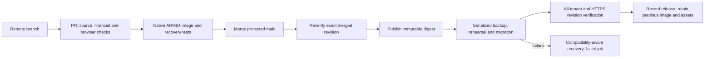

# Hardening implementation and verification — 26 October 2026

This is the implementation follow-up to the architecture review. The rollout targets a few businesses and 5–10 users. The application remains a Next.js modular monolith with one SQLite database per business. No database rebuild or replacement was needed.

**Release status: implemented, merged and deployed.** Production and local `main` are at `32df273e5eeecec3db15f95bd8ba8d0f1cc1cd93`. [Final verification/deployment run 40325451736](https://github.com/MuhammadRayyan/erp-software-2.0/actions/runs/40325451736) passed every required job. Changes merged through [PR #1](https://github.com/MuhammadRayyan/erp-software-2.0/pull/1), [PR #12](https://github.com/MuhammadRayyan/erp-software-2.0/pull/12) and [PR #15](https://github.com/MuhammadRayyan/erp-software-2.0/pull/15). The initial backup failure, safe fallback and subsequent Chromium correction are recorded below.

**Owner's testing-phase decision:** keep the repository public and defer the remaining hardening/backlog. Retain the implemented fixes and existing CI/deployment checks. [Testing-phase operations](TESTING_PHASE_OPERATIONS_2026-10-26.md) records completed server/OCI/Sentry checks and privately configured read-only account access. OCI passed 13 local API checks with zero failures; historical Sentry events and existing monitors/workflow are verified. Settled cloud entitlement and current-release Sentry ingestion/delivery remain unproven. [NEXT_STEPS.md](NEXT_STEPS.md) owns the testing checklist. Do not treat the backlog below as authorization to implement it during testing.

## Work completed

| Requested work | Implementation | Outcome |
|---|---|---|
| Ignore Manager.io backups | Removed the explicit Git ignore exception; ignored Manager/native backup formats, database files, backup directories, runtime secret files and release outputs. Docker also excludes secret files and generated/local artifacts. | Future accidental additions/build inclusions are prevented. The already tracked backup and its history remain, as requested. |
| Safe authentication setup | Production rejects missing, short and known placeholder authentication secrets. A VM-local provisioning script generates independent random authentication/setup keys, mode 0600, and schedules session/token invalidation. Runtime secrets are injected through a private file. | New values were generated on the VM and were never printed or sent through chat. Final runtime/session verification is recorded below. |
| Permission enforcement | Shared domain guards cover 147 business command functions. Actions, batch/conversion paths, settings, document exports and API routes enforce action permissions. Account state is rechecked; suspended accounts cannot keep using a valid cookie. | View-only and create-only regression cases pass; draft intent cannot bypass posting permission when changing a posted document. |
| Tenant financial privacy | Dashboard queries run only for authorized modules; financial summaries/charts are gated. Email history is filtered by the related document module. Production trusted origins use configuration only. | Warehouse users receive an explanatory state without financial data; forged request headers cannot add trusted origins. |
| Payroll state transitions | Status is server-controlled; posting creates its journal transactionally, reposting is idempotent, posted payroll is immutable, and corrections use void/new draft. Unknown record IDs cannot silently create records under edit permission. | A posted payslip without a journal can no longer be created through the save service. |
| Shared financial math | Shared purchase settlement expressions include posted debit notes in invoice detail and AP aging. Payroll/FX aggregation uses checked minor-unit helpers; EOSB uses exact ratios and strict dates. Cash-basis allocation reporting uses decimal aggregation rather than SQLite REAL. | The original AP/EOSB defects pass regression checks, including reversal behavior, large safe-integer values and rounding boundaries. |
| Reconciliation | Integrity checks validate all registered schemas, foreign keys, journal balance/minimum lines, payroll totals/linkage, and posted document journal existence. | The stronger read-only checks passed on the live system database and all six business databases before rollout. |
| Automatic releases | Protected main, required PR checks, pinned Actions/base images, native ARM64 image verification, digest promotion, verified SSH, deployment serialization, preflight proxy/Compose checks, backup verification, migration rehearsal, tenant readiness and HTTPS/revision checks. | GitHub protection/environment/host-key configuration is applied. Each image includes revision/schema metadata and a locked production npm CycloneDX inventory; CI retains release evidence. |
| Recovery | Release metadata, old image/configuration and immutable static assets are retained. Backups recover a private writable copy of the frozen SQLite files/sidecars and produce self-contained snapshots. Automatic fallback requires schema compatibility; failures remain red. | Eight isolated deployment scenarios pass, including backup timeout and unsafe-schema fallback refusal. Disposable native ARM64 tests preserve committed system/tenant WAL rows and attachments, and restore/migrate/reconcile successfully. |
| Consistent UX | Shared permission-aware Button/menu controls, create/edit route gates, workflow-aware document footers, and the existing form-error/footer components are reused. Payroll amounts use currency precision consistently. | Five production-browser scenarios passed, including preserved input after validation and a 390-pixel mobile viewport. |
| Native HTML PDF verification | Chromium configuration/cache live under the existing temporary filesystem. A bundled diagnostic invokes the application's actual renderer under non-root, read-only, network-isolated container constraints. | The original crash-report-directory launch failure was reproduced. With corrected paths, the actual renderer produced a valid 19,203-byte synthetic PDF on the production ARM64 host. The diagnostic is now an image gate. |
| Dependency hygiene | Updated Next.js, templates, SMTP/validation dependencies and vulnerable transitive packages; added dependency update PR configuration. | Production dependency audit: zero findings. Four moderate development-tool advisories remain in Drizzle tooling; they are excluded from the production runtime audit. |
| Production email truthfulness | A missing SMTP provider produces a configuration failure in production; it no longer records simulated success. | Real delivery still needs an SMTP account and a verified sender/test message. |

## Verification evidence

- **345 unit/integration tests passed in native ARM64 PR CI**, with zero failures/skips. The new hardening file contributes 13 tests. Five production-browser scenarios pass separately.
- Full TypeScript checking and lint passed. Generated development/build artifacts are excluded from lint; generated production route types remain part of verification.
- Production Next.js builds passed locally. Final native ARM64 CI verifies the actual image, native SQLite dependency, actual HTML PDF rendering, committed-WAL/clean-WAL backup and restore, startup, migrations, readiness and login route.
- Five isolated Playwright scenarios passed: restricted warehouse overview, sales viewer create/export denial, create-only draft workflow, payroll error recovery with input preservation, and mobile containment.
- Permission boundary coverage checks 147 domain commands. Runtime tests cover denial and permitted workflows; the coverage script is an additional guard, not a substitute for those tests.
- Deployment scenarios passed: success, image-pull failure, backup failure, backup timeout, rehearsal failure, migration failure, failed health verification, and incompatible schema. The prior release is restored only when safe, and the job remains failed.
- A disposable full application snapshot was checksummed, restored to a different temporary directory, migrated and reconciled successfully.
- Live read-only preflight passed: system schema 6; six business schemas 35; integrity, foreign keys and the stronger financial reconciliation checks passed.
- Candidate Compose and Caddy configuration validated on the actual VM before deployment. Docker Compose reports v5.6.1.
- Repository protection requires the two named verification checks, an up-to-date PR, linear history and resolved conversations. Force pushes/deletions and administrator bypass are blocked. The production environment allows protected branches; the workflow restricts deployment to main.

Business mutation tests use disposable fixtures. Post-deployment production checks inspect readiness, configuration, database integrity/reconciliation and static assets; they do not create accounting transactions in customer businesses. A cryptographically signed accounting audit trail, regulatory e-invoicing certification and a complete screen-by-screen UX/accessibility review are not claimed by these checks.

The original broad review and this implementation do not constitute an exhaustive penetration test, statutory accounting certification, or a production load test.

## First activation failure and correction

The first main release was `f13ca5e544c083c2e9b5fe60c7afab2ed43d5f70`, image digest `sha256:37494610f472805fbf9227ebc217f5e93b292e6e5e8337066be5eb532e30fa7e`. [Deployment run 40249277270](https://github.com/MuhammadRayyan/erp-software-2.0/actions/runs/40249277270) passed source/browser and image verification, then stalled in the native SQLite backup against the production read-only data mount. No production migration had started. The stalled backup container was stopped; the script automatically restored the previous image/configuration and kept the job failed. Service interruption was approximately four minutes, from 00:34:29 to 00:38:29 UTC on 26 October.

The initial image checks did not exercise backup/restore; the earlier successful Windows restore test was insufficient. The corrected image test covers both committed uncheckpointed WAL and a clean WAL database with no sidecars, on an actual ARM64 Linux image and a read-only source. The old implementation reproduced an inability to open the clean-WAL source; the revised implementation passed content, attachment, checksum and restoration checks on disposable server data. This establishes the corrected recovery behavior without claiming a complete explanation of the original native spin.

SQLite now recovers/checks a private writable copy, creates snapshots via its backup API, and switches snapshot files to DELETE journal mode so read-only inspection does not require sidecar creation. The original frozen source is untouched. Backup/checksum operations are bounded to 60 seconds, rehearsal to 120 seconds and migration to 300 seconds, with named-container cleanup. A timeout invokes the same compatibility-aware recovery and remains a failed deployment.

## Verified production activation

The corrected hardening release first deployed through [run 40318215319](https://github.com/MuhammadRayyan/erp-software-2.0/actions/runs/40318215319) at 11:59:54 UTC on 26 October. A separate actual-render check then found Chromium's crash-report initialization failing because its configuration directory was unwritable in the non-root read-only container. The issue affected the custom HTML PDF path; ordinary application/database checks remained healthy. The failure was reproduced on disposable data, corrected with temporary XDG paths, and added to the required image gate using the application's actual renderer. Chromium documents these configuration overrides in its [user data directory guide](https://chromium.googlesource.com/chromium/src/+/HEAD/docs/user_data_dir.md).

The final correction deployed automatically through [run 40325451736](https://github.com/MuhammadRayyan/erp-software-2.0/actions/runs/40325451736) at **12:57:26 UTC on 26 October**. Source/financial/browser verification, ARM64 image verification and production deployment all passed. The actual live container also rendered the diagnostic PDF successfully after activation.

| Evidence | Verified value |
|---|---|
| Git revision | `32df273e5eeecec3db15f95bd8ba8d0f1cc1cd93` |
| Immutable image | `ghcr.io/muhammadrayyan/erp-software-2.0@sha256:c7a9083dc40d93dcb27141318cba16f809d8a2e86cc593b317e29a59e819d4dc` |
| Runtime | UID/GID 10001; read-only root; 3 GiB memory; PID limit 256; bounded JSON logs; external migrations |
| Secret checks | Authentication/setup keys exceed 48 characters; authentication default false; runtime file mode 0600; no baked `.env`, `.env.local` or Manager backup |
| Revocation | Sessions and pending verification tokens invalidated during deployment; invalidation marker removed |
| Databases | System schema 6; six businesses at schema 35; integrity, foreign keys and financial reconciliation pass |
| Deployment snapshot | `/opt/modern-erp/backups/20261026T125716Z-32df273e5eeecec3db15f95bd8ba8d0f1cc1cd93`; seven databases; 9,965,568 bytes; manifest verified and restore/migration rehearsed |
| Recovery | Prior hardened image `sha256:0595fa1dc55b8a78f74b2064c0293f504e90f3460362b88f44c9c4cd6719e5a9` retained under `modern-erp:rollback-20261026T125716Z`, with prior configuration |
| Public checks | HTTPS readiness returns the expected revision; liveness and login pass; direct HTTP root returns 404 |
| Browser assets | Both prior build manifests retain their original SHA-256; all 17 current login-page assets return HTTP 200 |
| HTML PDF | Actual live renderer produced a valid 19,203-byte PDF with the final runtime settings |
| Release evidence | CI retained `release-evidence-32df273e5eeecec3db15f95bd8ba8d0f1cc1cd93`, containing release/schema JSON and the production npm CycloneDX inventory; temporary host registry login directory removed |

Docker recorded the old process stop at 11:59:46.45 and the new container start at 11:59:50.95 UTC; the external probe observed the new healthy revision at 11:59:52.73. This release took about six seconds from stop to observed readiness, not a general downtime guarantee. The probe also had a separate short timeout while the old app was still running, so sampled client timeouts should not all be attributed to application maintenance.

For the final release, Docker recorded stop at 12:57:16.16 and container start at 12:57:19.63 UTC; the external probe observed the new healthy revision at 12:57:24.59: approximately **eight seconds from stop to observed readiness**. No further key rotation or business-schema change was needed for this correction.

After healthy activation, unused build cache older than 24 hours was reduced from 33.6 GB to 4.727 GB. Host usage fell from about 39 GB to 12 GB. After retaining the final image too, usage is about 13 GB with 84 GB free. Rollback image tags were retained; application data and local release snapshots were preserved.

The first failed release's partial backup directory is retained as diagnostic evidence and must not be used as a valid backup. The two later snapshots completed manifest verification and restore/migration rehearsal.

## If the repository becomes private

The deployed app, business data, users, domain and HTTPS continue operating. The new deployment flow does not fetch Git on the VM: Actions checks out the repository, transfers the exact release configuration over SSH, and supplies a job-scoped token for private image pulls. A permanent GitHub token on the server is not required for normal automatic deployment.

Developers/integrations need private-repository access. Private Actions usage is subject to the account's quota/billing, and private branch protection requires an eligible plan such as Pro/Team. GHCR package visibility and workflow access must also be checked separately. Manual image recovery needs an authorized package login. See the official references and operating procedure in [DEPLOYMENT.md](DEPLOYMENT.md).

The current `ubuntu-24.04-arm` runner label is supported in private repositories. GitHub lists two CPUs / 8 GB RAM there, compared with four CPUs / 16 GB RAM for public repositories, so measure build duration again after changing visibility. No ARM emulation or replacement production server is inherently required. [GitHub runner specifications](https://docs.github.com/en/actions/reference/runners/github-hosted-runners)

Both private branch protection and private environment deployment-branch restrictions need an eligible plan such as Pro/Team. Verify these controls immediately after a visibility change; the current account plan was not available through the inspected API. No manual deployment approval has been added. [Branch protection availability](https://docs.github.com/en/repositories/configuring-branches-and-merges-in-your-repository/managing-protected-branches/about-protected-branches), [environment branch restrictions](https://docs.github.com/en/actions/reference/workflows-and-actions/deployments-and-environments), [Actions quota and billing](https://docs.github.com/en/actions/concepts/billing-and-usage)

The current GitHub account's plan was not returned by the available API response, so plan eligibility has not been assumed. Repository visibility has not been changed. Ignore rules do not remove the already tracked backup, historical downloads, clones or forks.

## Deferred backlog during testing

| Priority | Task | Dependency / next acceptance evidence |
|---|---|---|
| Owner decision recorded; exposure remains | Keep the repository public for testing; real-data backup/history cleanup is deferred. | Only ignore rules were changed as requested; the tracked file remains publicly accessible. No visibility or history changes are requested. |
| Before broader onboarding | Configure scheduled encrypted offsite backups, retention and backup-age alerts. | Choose private object storage/credentials; complete a replacement-host restore drill before promising the proposed 15-minute RPO / one-hour RTO. |
| Before relying on email | Configure SMTP/provider and domain authentication, then verify actual invitation/reset/document delivery. | SMTP account and DNS access. Production currently reports unavailable delivery explicitly. |
| Before larger/untrusted imports | Stage imports before publishing a business, enforce quotas atomically across all create/import paths, and bound upload expansion/file counts. | Dedicated import lifecycle and failure/recovery tests. Native import ownership is corrected, but this is not the complete import redesign. |
| Financial audit hardening | Make the mandatory financial audit trail transactional/immutable and formalize corrections across all posted document types. | A reviewed accounting policy and reconciliation examples; payroll is immutable in this release. |
| Operational verification — completed within recorded scope | OCI identity/capabilities/membership/root policies, instance/storage/network/backup status, alarms/metrics; Sentry project, historical events and monitors/workflow verified. Read-only profiles are configured privately; GitHub/SSH work. | Remaining: settled OCI billing/free-tier entitlement and current-release Sentry ingestion/association/source maps/delivery. See the operations report. |
| Operational maintenance | Schedule the pending host reboot; establish recurring capacity/disk monitoring and explicit image/static-asset retention. | A maintenance window and measured recovery procedure. No OS reboot is bundled into this application release. |
| Deployment privilege reduction | Replace or validate the existing production SSH credential as a dedicated restricted deployment identity. | The existing Ubuntu/Docker administrative path works but retains broad host privileges. Use a separately provisioned forced-command key or a reviewed deployment service; keep operator recovery access independent. |
| Performance | Exercise realistic 10-user workloads with larger synthetic datasets; bound PDF/import job concurrency and improve whole-table dashboard/report reads. | Record p95 latency, event-loop delay, lock errors, memory and disk metrics. The small live dataset is not a capacity benchmark. |
| Upstream/framework | Track the Next.js per-response listener warning observed in browser verification. | The stack and upstream issue match proxy/APM listener overhead; no application memory leak was established and the warning was not suppressed. [Upstream issue](https://github.com/vercel/next.js/issues/97757) |
| Development dependencies | Review the remaining moderate Drizzle tooling advisories. | Upgrade or replace the development-only CLI without a forced incompatible downgrade. |
| Dependency peer alignment | Remove the need for the existing legacy peer install policy through compatible dependency updates and adapter-specific checks. | Current builds/tests use the locked `--legacy-peer-deps` graph. npm 10's strict SBOM validation highlighted peer-range gaps for optional resolver/Sentry/Webpack integrations, OpenTelemetry and Better Auth's SQLite peer; the inventory now uses the same install policy and does not claim those declarations are aligned. |

The proposed **15-minute recovery point target** means losing at most 15 minutes of recent work after a disaster. The **one-hour recovery time target** means restoring service within an hour of a host failure, assuming replacement capacity is available. Deployment snapshots alone do not establish either target; scheduled offsite backups and a timed replacement-host restore are the next acceptance steps.

## Operating notes

Use [DEPLOYMENT.md](DEPLOYMENT.md) as the canonical runbook. Normal releases originate in a PR and deploy after merge. Emergency dispatch on main uses the same checks. Builds may fail; verification prevents those builds from being promoted. A single app instance has a short maintenance interval rather than a zero-downtime guarantee.

UI changes standardize permission visibility, form errors and document workflow controls through shared components. The browser evidence covers the named critical workflows; a full accessibility/usability review of every screen remains outside that verified coverage.

Runtime secrets are stable across ordinary releases. The initial replacement signs users out and revokes pending verification links; users may need new invitation/reset links. No business-data rebuild is part of the release.

Use Node 22 and npm 10 for routine local work as selected by `.nvmrc` and the project metadata. This machine's default remains Node 24.15.0/npm 11.12.1; it was not changed globally. The release's authoritative checks and builds ran on Node 22 and the final Linux ARM64 image.

The VM's old Git checkout is no longer the authority for deployed application code. Use the image digest, OCI revision label, release metadata and health revision. Do not run the old `git reset`/build-on-server procedure.

This report is kept local and is not included in the public implementation PR.
